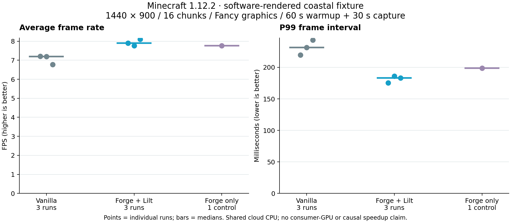

# Validation results — 11 November 2026

The production JAR builds and runs in Minecraft 1.12.2 with Forge 14.23.5.2860.
The Studio, HUD editor, profile workflow and actual Minecraft font hook have been
exercised in the game. **240+ FPS at 16 chunks and maximum graphics has not been
demonstrated.** These measurements use software rendering in a shared cloud
environment and do not establish a consumer-GPU performance improvement.

## Environment

| Item | Recorded value |
|---|---|
| CPU | Intel Xeon Platinum 8573C; 3 CPUs in the process affinity mask, container quota equivalent to 2 CPU cores; the internal capture reported 2 processors available to Java |
| Memory | 8 GiB container limit; Java `-Xms512M -Xmx2G` |
| Renderer | Mesa llvmpipe, LLVM 19.1.7, 256 bits; software rendering |
| OpenGL | 4.5 compatibility profile; Mesa 25.0.7-2+deb13u1 |
| OS | Linux x86_64, kernel 6.18.57 |
| Java | Eclipse Temurin 8u512-b09, 64 bit |
| Display | Xvfb, windowed 1440×900; no physical display or meaningful presentation latency |
| Game | Genuine vanilla 1.12.2 compared with Forge 14.23.5.2860 + Lilt 1.0.0 |
| Graphics | 16 chunks, Fancy, maximum smooth lighting, Fancy clouds, all particles, 4 mipmap levels, VBOs and entity shadows on; default resources and 70° FOV |
| Timing | VSync off and vanilla unlimited setting (260), explicitly selected for testing |

The client does not change these graphics or JVM settings. Software rendering
shares the limited CPU budget with the game, integrated server and X server.
Initial chunk generation caused vanilla integrated-server overload warnings.
There is no dedicated GPU utilization measurement, physical input latency result,
thermal/power characterization or internet multiplayer measurement here.

## Successful checks

- Production reobfuscated JAR loaded in a normal Forge runtime, separate from the
  development launch classpath, and joined an integrated world.
- 13 JUnit tests passed: cache bounds/thread isolation/invalidation, executable
  transformed-class verification, configuration corruption/recovery/order and
  frame statistics. The optional probe passed a real JVM instrumentation smoke
  test; the Python CSV analyzer test passed.
- Actual Minecraft `FontRenderer` passed all **72** cached/uncached parity checks:
  null/empty input, formatting, multilingual text, Unicode and bidi combinations.
- F3+T resource reload completed and rendering resumed. No world, entity, movement,
  combat or network class is transformed by the client. This source boundary is
  not a substitute for a full gameplay/modpack compatibility suite.
- Studio navigation, module toggles, per-module opacity and HEX editing, theme
  selection, profile save/export/import, dragging, mouse-wheel sizing and arrow
  nudging were exercised. Export/import JSON matched exactly. The active profile,
  scale, position and opacity persisted across restart.
- The Compact preset placed four enabled HUD modules without overlap. Runtime
  review caught and corrected an LWJGL 2 sixteen-float buffer requirement in GL
  state restoration; the corrected build rendered Studio/editor and returned to
  the ordinary Minecraft menu successfully.
- The Python installation helper passed fresh-copy, same-JAR idempotence and
  existing-JAR backup checks against an isolated test game directory.

## Matched vanilla comparison

Three alternating runs per variant used the same external loop-entry Java agent,
fresh JVMs, matching settings and fresh copies of one closed-world snapshot.
Each run warmed up for **60 seconds**, then captured **30 seconds**. A final
Forge-only run provides one exploratory control. The fixture is a stationary,
creative-mode view across normal-generator ocean/shoreline, seed 20261110,
position 8.5/90/8.5, yaw 135°, pitch 20°. Time, weather and spawning were explicitly
controlled in the fixture. This is not a representative survival traversal.

| Run | Frames | Avg FPS | 1% low FPS | P99 ms | CPU mean | Heap mean MiB | GC count / total ms |
|---|---:|---:|---:|---:|---:|---:|---:|
| Vanilla 1 | 217 | 7.20 | 4.05 | 219.55 | 98.9% | 518.1 | 0 / 0 |
| Lilt 1 | 237 | 7.90 | 5.51 | 175.36 | 99.4% | 528.3 | 1 / 6 |
| Vanilla 2 | 217 | 7.20 | 3.75 | 231.70 | 99.2% | 567.4 | 1 / 16 |
| Lilt 2 | 234 | 7.77 | 4.47 | 186.02 | 98.9% | 571.6 | 1 / 68 |
| Vanilla 3 | 204 | 6.78 | 3.98 | 243.40 | 99.4% | 540.7 | 1 / 13 |
| Lilt 3 | 244 | 8.11 | 4.98 | 183.25 | 99.4% | 580.6 | 1 / 25 |
| Forge-only control | 233 | 7.76 | 4.87 | 198.82 | 99.1% | 559.9 | 1 / 45 |

Median average FPS was **7.20 vanilla** (range 6.78–7.20) and **7.90 Forge + Lilt**
(range 7.77–8.11). The Forge-only control was **7.76 FPS**. **These results do not
establish a gameplay FPS improvement caused by Lilt.** The loader, short warmup,
remaining chunk/JIT work and shared-CPU variation prevent that attribution.
The narrow repeated-text lookup result below is the measured optimization evidence.

All **1,586 comparison intervals** were in-world with no GUI open. Lilt used its
default FPS HUD + text cache profile; other modules were disabled. CPU percentages
are process CPU share of JVM-visible processors, not a vendor GPU counter.
Heap means exclude off-heap/native/GPU memory. GC count/time deltas span the
first-to-last 1 Hz system sample, slightly less than the full frame capture;
they are not individual pause durations. Full percentiles, maximum intervals,
standard deviations, heap peaks and raw samples are in `benchmarks/comparison.json`
and the accompanying CSVs.

With only about 200–250 frames per run, the 1% tail represents just three
intervals. This shortened campaign validates the measurement pipeline and
records observations; it does not satisfy the longer six-scenario protocol or
the 240 FPS hardware target. The [evidence README](../benchmarks/README.md),
generated-world snapshot, settings, hashes and probe instructions allow reruns.

## Built-in recorder functional check

A 60-second F8 capture completed with 342 gameplay intervals: **5.69 average FPS,
2.66 FPS 1% low, 306.79 ms P99**. All 342 intervals were in-world with no GUI open.
Its CSV and JSON metadata are retained in `benchmarks/20261111-171553-820-*`.
The profile enabled FPS, frame graph, coordinates, memory and text caching.
This check began after resuming the fixture and includes chunk-loading work;
it is a recorder/UI validation, not a controlled vanilla comparison. Its Forge
RenderTick hook differs from the external probe's loop-entry hook.

Screenshots in `docs/screenshots` show the actual Studio, per-module Appearance
screen, four-module Compact editor layout and gameplay HUD. Menu/editor numbers
are live rolling measurements, not benchmark claims.

## Text-width computation only

The explicit `/lilt fontcheck` diagnostic uses 128 repeated scoreboard-style
strings, 100,000 warmup lookups and 500,000 timed lookups per mode, over five
alternating-order rounds. Raw results are in `benchmarks/font-check.json`.

| Round | Cached ns/lookup | Uncached ns/lookup |
|---|---:|---:|
| 1 | 128.86 | 2738.38 |
| 2 | 37.86 | 3818.61 |
| 3 | 25.27 | 2226.17 |
| 4 | 26.50 | 1456.01 |
| 5 | 26.01 | 1179.56 |

Medians were 26.50 ns cached and 2226.17 ns uncached in this synthetic reuse
workload. Large warmup/order effects and shared-CPU variation are visible in the
raw rounds. This is **not JMH**, a general text workload, or a whole-game FPS
multiplier. The explicit diagnostic blocks the game thread briefly and was kept
outside gameplay captures. It supports the narrow repeated-width hypothesis;
it does not identify the dominant gameplay bottleneck.

## Remaining acceptance work

| Requested coverage | Status |
|---|---|
| Representative 240+ FPS at 16 chunks / max quality | Unverified; requires a real GPU and named hardware configurations |
| Empty world | Procedure supplied; dedicated void-world comparison not performed |
| Normal survival traversal | Static normal-generator fixture only; no representative survival movement route |
| Complex terrain and cold chunk traversal | Not benchmarked separately |
| Multiplayer | No authenticated external multiplayer session tested |
| Many entities | No controlled high-entity-count comparison |
| Extended sessions | No 60–120-minute soak test |
| GPU utilization / input-to-photon | Not measured; external instruments required |
| GC pause distribution | Aggregate MXBean count/time only; no individual pause histogram |
| Other GPUs, operating systems, resource packs and coremods | Not certified |

Follow `BENCHMARKING.md` for the longer, repeated six-scenario campaign. The
packaged probe and analyzer are ready to use on an existing licensed installation.
Lilt 1.0 is a functioning client and measurement foundation; it does not yet have
evidence supporting parity with established commercial performance clients.
